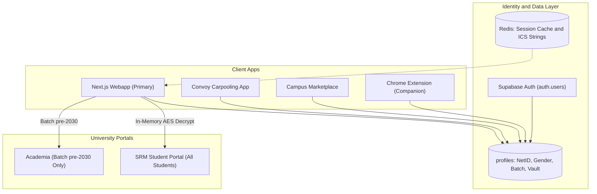

# Unfugly Ecosystem V3

**A modern, unified digital platform for SRMIST students — delivering intuitive academic tooling, intelligent calendar sync, predictive analytics, campus carpooling, and verified student commerce.**

---

## 🌟 The Unfugly Ecosystem

Unfugly has evolved from an extension-based scraper into a **Webapp-First Ecosystem** powered by a single Supabase backend and verified student identity layer:

1. **[Next.js Webapp (Primary Application)](file:///webapp)**:
   - High-fidelity dark mode dashboard with Inter typography and smooth transitions.
   - Interactive weekly timetable grid (Day Orders 1–5, Hours 1–12) with custom slot editing.
   - SGPA & CGPA "what-if" predictive modeling based on enrolled credits and expected marks.
   - Manual and automated OD/ML simulation with safe-bunk buffer calculations.
   - Dedicated Exam Timetable card with seating and hall ticket integration.
   - Extracted Previous Year Questions (PYQ) intelligence tab.

2. **[Express Backend API (unfugly-backend)](file:///unfugly-backend)**:
   - Node.js & Express API serving `/api/v1` (legacy support) and `/api/v2` (V3 architecture).
   - In-memory AES-256-GCM credential vault for Student Portal (`sp.srmist.edu.in`) and legacy Academia (`academia.srmist.edu.in`).
   - Automated, zero-latency Student Portal login handshake with client-side SVG CAPTCHA parsing.
   - Redis-cached RFC 5545 iCalendar (`webcal://` / `.ics`) subscription feed with $O(1)$ day-order shift invalidation.
   - Razorpay subscription integration for semester-pass access.

3. **[Convoy App (Campus Carpooling)](file:///docs/NEW_ARCHITECTURE.md#7-multi-app-expansion-convoy--marketplace)**:
   - Safe, peer-to-peer campus ride sharing sharing the same database.
   - Verified passenger and driver gender checks directly from Student Portal profile records (`female_only`, `male_only`, `any`).

4. **[Campus Marketplace](file:///docs/NEW_ARCHITECTURE.md#7-multi-app-expansion-convoy--marketplace)**:
   - Verified student marketplace for textbooks, lab coats, and electronics with zero anonymous accounts.

5. **[Chrome Extension (Companion)](file:///extension)**:
   - Optional companion script for inline attendance margin calculations and session synchronization.

---

## 🏛️ V3 Architecture Overview



---

## 📂 Project Structure

```
Unfugly/
├── webapp/                 # Next.js web application (Primary UI)
├── unfugly-backend/        # Express API v1/v2, scrapers, and Redis workers
│   ├── migrations/         # Supabase SQL schema migrations
│   ├── routes/v1/          # Legacy extension and user routes
│   └── routes/v2/          # V3 architecture routes
├── extension/              # Chrome extension companion source
├── docs/                   # Architectural blueprints & specifications
│   └── NEW_ARCHITECTURE.md # Full V3 technical specification
└── README.md               # This documentation
```

---

## 📖 Key Documentation

- 📘 **[V3 Technical Architecture Blueprint](file:///docs/NEW_ARCHITECTURE.md)**: Deep dive into schema, encryption vaults, CAPTCHA bypass mechanics, calendar engine, and predictive math.
- 🗄️ **[Database Migration Script](file:///unfugly-backend/migrations/20261115_v3_schema.sql)**: Non-destructive Supabase SQL migration for `profiles`, overrides, timetables, and convoy tables.
- 🛡️ **[Workspace Rules](file:///.agents/AGENTS.md)**: Development guidelines, commit conventions, and security constraints.
