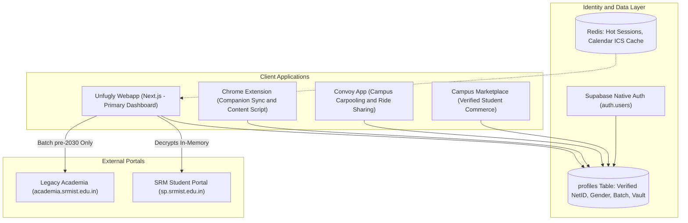
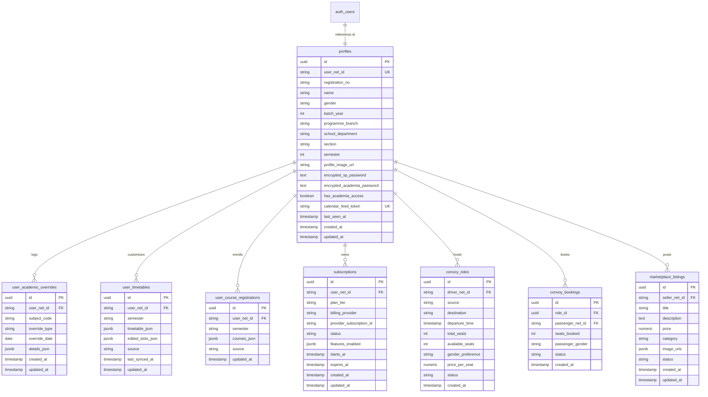
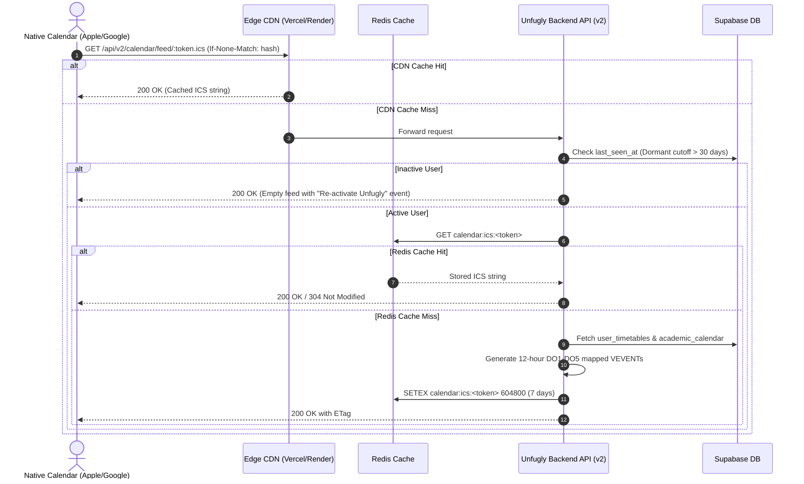

# Unfugly Ecosystem V3 Architecture Specification

> **Status:** Approved Architecture Draft  
> **Applies to:** Webapp (Primary), Backend API (v2), Extension (Companion), Convoy App, Campus Marketplace  
> **Target Graduation Batches:** Legacy (<=2029) and Modern (2030+)

---

## 1. System Vision & Product Evolution

Unfugly is transitioning from a Chrome-extension-first utility into an integrated, **Webapp-first university ecosystem** powered by a single Supabase backend and identity layer.



### Key Paradigm Shifts:
1. **Webapp-First**: The Next.js web application is the core hub for student operations. The Chrome extension is now an optional companion tool.
2. **Lean Persistence**: Unfugly no longer stores heavy raw marks and attendance dumps in PostgreSQL. Live data is fetched on demand or cached in Redis; only user-added overrides (expected marks, manual OD/ML) and structured timetables are permanently stored.
3. **Cross-Product Identity**: The unified `profiles` table powers:
   - **Unfugly Webapp**: Academic schedule, attendance prediction, SGPA simulation.
   - **Convoy**: Campus carpooling with verified gender filtering (`female_only`, `male_only`, `any`) directly from portal records.
   - **Campus Marketplace**: Verified student-to-student buying and selling with zero anonymous accounts.
4. **Monetization Layer**: Premium features (Calendar `.ics` feed, PYQ analysis & question bank) gated via a dedicated `subscriptions` table.

---

## 2. Database Schema (PostgreSQL / Supabase)

All tables use `snake_case` naming and are designed to be **strictly non-destructive**: existing `users`, `user_logs`, and `academic_calendar` tables remain intact for backward compatibility.

### 2.1 Entity Relationship Diagram



### 2.2 Table Specifications

#### `profiles`
- `id`: UUID Primary Key, foreign key referencing Supabase `auth.users(id)`.
- `user_net_id`: Unique SRM NetID (e.g., `gr2383`). Email is implicitly `${user_net_id}@srmist.edu.in`.
- `registration_no`: Official SRM Registration Number (e.g., `RA2311003010...`).
- `name`: Student's full name.
- `gender`: Verified student gender (`'male'`, `'female'`, `'other'`), scraped exclusively from Student Portal Personal Details (`iden=17`).
- `batch_year`: **Year of graduation** (e.g., `2026`, `2027`, `2028`, `2029`, `2030`).
- `has_academia_access`: Boolean computed as `(batch_year < 2030)`. Students graduating in 2030+ reside entirely on Student Portal.
- `programme_branch`, `school_department`, `section`, `semester`, `profile_image_url`.
- `encrypted_sp_password`: Combined string formatted as `base64(iv):base64(auth_tag):base64(ciphertext)` for Student Portal credentials (all students).
- `encrypted_academia_password`: Formatted as `base64(iv):base64(auth_tag):base64(ciphertext)` for Academia credentials (null for batch 2030+).
- `calendar_feed_token`: Secure random hex token for external `.ics` feeds.
- `last_seen_at`: Timestamp updated on webapp/extension activity for dormant account detection.

#### `user_academic_overrides`
- Stores user-added expected marks and manual OD/ML entries without persisting raw dumps.
- `override_type`:
  - `'expected_marks'`: User's simulated scores for internal evaluation components (CLA1, CLA2, FT1, Assignments) and expected End-Sem mark.
  - `'manual_od'`: Manually recorded On-Duty.
  - `'manual_ml'`: Manually recorded Medical Leave.
- `override_date`: Specific date chosen by the user.
- `details_json`:
  - For OD/ML: **Full-day by default**. Contains `{ "all_day": true, "excluded_hours": [], "category": "OD", "reason": "Tech fest" }`. When `all_day: true`, the prediction engine automatically flags all scheduled periods on that date's Day Order as attended via OD/ML.

#### `user_timetables`
- `timetable_json`: Weekly period matrix for Day Orders 1 through 5, supporting **up to 12 periods per day** (Hours 1 to 12).
- `edited_slots_json`: Custom modifications (user-renamed courses, room adjustments, swapped faculty).

#### `user_course_registrations`
- Stores current semester enrolled subjects:
  ```json
  [
    {
      "course_code": "21CSC302J",
      "course_title": "Database Management Systems",
      "credits": 4,
      "course_type": "Theory with Practical",
      "slot": "A1+TA1",
      "faculty_name": "Dr. ...",
      "room_no": "TP402"
    }
  ]
  ```

#### `subscriptions`
- Gating for paid features (`live_calendar_sync`, `pyq_predictions`).
- Tracks plan tier (`free`, `semester_pass`, `annual_pass`), expiration, and active status.

---

## 3. Cryptography: AES-256-GCM Vault

### What are IV and Tag?
- **IV (Initialization Vector / Nonce)**: A 12-byte cryptographically secure random number generated fresh on every encryption operation. Even if two users share the same password, their ciphertexts are completely distinct, preventing pattern analysis and rainbow table matching.
- **Auth Tag**: A 16-byte cryptographic checksum computed by Galois/Counter Mode (GCM). During decryption, GCM verifies that the ciphertext has not been modified or corrupted. If even one bit is tampered with in the database, decryption immediately rejects the payload.

### Combined Storage Format:
To avoid adding 6 separate database columns for IVs and Tags, credentials are encrypted and stored in a single unified string:
```text
encrypted_sp_password = "<base64_iv>:<base64_tag>:<base64_ciphertext>"
```
- Decryption is performed strictly **in-memory** on the server when a live sync or scraping job is initiated.
- Plaintext passwords and session cookies are never written to logs, console, or client responses.

---

## 4. Student Portal Scraper & Security Handshake

### 4.1 Reverse-Engineered Security Topology & Anti-Bot Architecture
Analysis of live Student Portal (`sp.srmist.edu.in`) traffic and client-side security modules (`guardlogin.js`, `secure2.js`, `guardloginbottom.js`) reveals a multi-layered defense system:

1. **The Decoy Honeypot Trap (`captchaText`)**:
   - The JSP embeds a decoy token `window.SECURE_CONFIG.captchaText = '...'` in the HTML.
   - **Crucial Finding**: Submitting this text triggers an immediate security alert (`Invalid captcha.`). It is designed to trap naive scrapers and report them to `/api/log-phishing`.
   - The real CAPTCHA image is generated server-side by `GET /srmiststudentportal/SCaptchaServlet?ts=<timestamp>&token=<guid>`.
2. **Domain-Proof Handshake (`X-Domain-Proof`)**:
   - To acquire the real CAPTCHA binary PNG, the client must submit the header:
     $$\text{X-Domain-Proof} = \text{base64}(\text{sessionNonce} + \text{":sp.srmist.edu.in"})$$
   - Along with strict browser CORS navigation headers (`Sec-Fetch-Dest: empty`, `Sec-Fetch-Mode: cors`, `Sec-Fetch-Site: same-origin`).
3. **Form-Level Bot Traps**:
   - Dynamic hidden honeypot text input: `<input type="text" name="ph_<hash>" tabindex="-1">` (must be submitted empty).
   - Dynamic domain token: `dtoken_<hash> = base64(reverse("sp.srmist.edu.in"))`.
   - Dynamic interaction token: `cptoken_<hash> = base64(elapsedSeconds + randomDelimiter + interactionCount)`.
   - Client telemetry blob: `telemetryPayload = base64(JSON.stringify(telemetryMetadata))`.

### 4.2 Automated Sub-Second Login Pipeline:
The backend executes a seamless, zero-cloud-cost automated handshake:
1. **GET `youLogin.jsp`**: Extracts `nonce`, `domainFieldName`, `captchaFieldName`, `randomDelimiter`, `honeypotName`, and `captchaUrl`.
2. **GET `SCaptchaServlet`**: Requests the binary PNG using the computed `X-Domain-Proof` header.
3. **Instant Local Solving (<50ms)**: Solves the 6-character captcha using in-process WebAssembly Tesseract.js (`utils/captchaSolver.js`) with offline `eng.traineddata`, achieving sub-second recognition with zero Python processes, zero subshell overhead, and zero third-party solver fees.
4. **POST `LoginServlet`**: Submits credentials, empty honeypot, solved captcha, telemetry payload, and dynamic tokens.
5. **Session Verification & Extraction**:
   - Confirms entry into `students/template/HRDSystem.jsp`.
   - Automatically queries `studentPersonalDetails.jsp` (`iden=17`) to extract verified **Full Name**, **Registration Number**, **Gender** (`male`/`female`), **Program/Branch**, **Semester**, and **Graduation Batch Year**.
   - Computes `has_academia_access = (batch_year < 2030)`.
   - Encrypts student password via AES-256-GCM (AAD bound to `user_net_id`) and upserts into Supabase `public.profiles`.

---

## 5. Software Features & Predictive Engines

### 5.1 Native Calendar Subscription Feed (`webcal://` / `.ics`) — *Paid Feature*



#### Shift Handling via Global Invalidation:
- **Global University Calendar**: SRM's day-order shifts are stored once in `academic_calendar` (e.g. `{ "2026-11-20": "DO4", "2026-11-21": "HOLIDAY", "2026-11-24": "DO5" }`).
- When a holiday shifts the schedule, the backend updates `academic_calendar` once ($O(1)$) and issues a Redis command `DEL calendar:ics:*`.
- No massive background jobs; as client devices ping the feed over the next 12 hours, the schedule recalculates automatically on cache miss.
- **Zombie Ping Defenses & Permanent Event Retention**:
  - `ETag` + `304 Not Modified` header check (sends 0 KB body for unchanged feeds).
  - **Permanent Semester Retention (No Calendar Wipes)**: Returning `410 Gone` causes Google and Apple Calendar to delete the entire calendar feed, erasing students' past class and attendance history. Instead, when a semester concludes, the server serves the final frozen schedule with `Cache-Control: public, max-age=31536000, immutable` and a terminal `ETag`. Any future check by the client immediately hits `304 Not Modified` (0 bytes body), keeping historical dates permanently on the user's phone with zero server computation.
  - Dormant account cutoff: Accounts inactive for >30 days receive an empty calendar with a reminder event.

### 5.2 Exam Timetable & Hall Ticket
- **Timetable (`iden=126`)**: Fetches subject code, course title, date, slot, and session (`FN`: 09:30 AM–12:30 PM, `AN`: 01:30 PM–04:30 PM).
- **Hall Ticket (`iden=42`)**: Closer to the exam date, SRM populates hall and seating allocations. The parser extracts Hall Number, Seat/Row Allocation, and reporting guidelines directly into the exam card.

### 5.3 SGPA & CGPA Predictive Modeling
- **Prior Academic Record**: Extracted from `studentMarksCredits.jsp` (`iden=8`) for historical credits and CGPA.
- **Current Enrolled Courses**: From `user_course_registrations`.
- **Formulas**:
  $$\text{SGPA} = \frac{\sum (\text{Course Credits} \times \text{Grade Point})}{\sum \text{Course Credits}}$$
  $$\text{CGPA}_{\text{new}} = \frac{(\text{Prior CGPA} \times \text{Prior Credits}) + (\text{Predicted SGPA} \times \text{Current Credits})}{\text{Prior Credits} + \text{Current Credits}}$$
- Incorporates user-defined expected marks from `user_academic_overrides` for instant "what-if" grade simulation.

### 5.4 Manual & Automated OD/ML Attendance Prediction
- **Graduating Batches <=2029**: Approved OD is not displayed on portals. Users log OD dates in the webapp; the engine assumes full-day coverage (all classes for that day order) and projects adjusted attendance percentages and safe bunks.
- **Graduating Batches 2030+**: Approved OD/ML hours appear directly in the Student Portal attendance table (`iden=9`). The parser ingests official OD automatically and merges user-added pending ODs for simulation.
- **Buffer Formula**:
  $$\text{Safe Bunks} = \left\lfloor \frac{\text{Attended Hours} + \text{OD Hours} - (0.75 \times (\text{Total Hours} + \text{Planned Hours}))}{0.75} \right\rfloor$$

### 5.5 Dynamic PYQ Analysis & Question Extraction — *Paid Tab*
- **Current-Semester Scoped Filtering**: The webapp automatically joins the user's current enrolled course codes from `user_course_registrations` with `pyq_questions`. Students are presented **only** with the PYQs matching their active semester courses, organized under separate subject accordion sections inside the PYQs tab.
- **Extraction Pipeline**: Instead of displaying static PDFs, questions are extracted and structured:
  ```json
  {
    "subject_code": "21CSC302J",
    "unit": 3,
    "marks": 16,
    "question_text": "Explain B+ Tree indexing with insertion and deletion algorithms.",
    "occurrences": 4,
    "exam_source": ["End-Sem Nov 2024", "End-Sem May 2025", "Model 2024"]
  }
  ```
- **Admin Ingestion**: The admin pastes raw paper text or uploads paper images/PDFs. The backend LLM/OCR worker extracts questions, assigns Bloom taxonomy levels, and indexes them by subject code.
- **Student Experience**: In a dedicated paid tab, students view high-probability questions grouped by syllabus unit, sorted by frequency, with practice tracking.

---

## 6. Payment & Subscription Provider Recommendation

For college students in India, **Razorpay Standard Checkout & UPI Payment Links** is the optimal choice:
- **Zero Friction**: 99% of Indian university students use UPI (Google Pay, PhonePe, Paytm). International processors (Stripe, Lemon Squeezy) require credit cards with 3D Secure, leading to >80% checkout abandonment.
- **Pricing Model**: **Semester Passes** (e.g., ₹49 to ₹99 per semester) or **Annual Passes** (₹149/year).
- **Integration**:
  1. Frontend calls `POST /api/v2/subscriptions/create-order`.
  2. Backend generates a Razorpay Order ID.
  3. Student completes UPI payment.
  4. Razorpay webhook hits `POST /api/v2/subscriptions/webhook`, verifying the payment signature and updating `subscriptions.status = 'active'`.

---

## 7. Multi-App Expansion: Convoy & Marketplace

### Convoy (Campus Carpooling)
- Built on top of the same `profiles` table.
- Drivers post rides with `gender_preference` (`'female_only'`, `'male_only'`, `'any'`).
- The booking system verifies the passenger's `profiles.gender` before confirming reservations, providing authentic portal-verified safety.

### Campus Marketplace
- Peer-to-peer buying and selling for textbooks, calculators, lab coats, and electronics.
- Verified accounts tied to SRM NetID eliminate anonymous scammers.

---

## 8. API Versioning & Route Monitoring Strategy

### 8.1 Route Versioning Guarantees
To ensure zero downtime and prevent breaking existing extension versions:
- **`/api/v1/...` (Strictly Frozen)**: Preserved exactly as-is for active extension builds (`/api/v1/user/save`, `/api/v1/auth/login`, `/api/v1/feedback`, etc.). No breaking changes or route renames may touch `/api/v1`.
- **`/api/v2/...` (Modern Architecture)**: Independent namespace for all V3 capabilities:
  - `POST /api/v2/auth/sync-session`
  - `POST /api/v2/user/vault-credentials`
  - `GET  /api/v2/calendar/feed/:token.ics`
  - `GET  /api/v2/exams`
  - `POST /api/v2/predict/sgpa`
  - `POST /api/v2/predict/attendance`
  - `GET  /api/v2/pyq/:subject_code`
  - `POST /api/v2/subscriptions/create-order`
  - `POST /api/v2/subscriptions/webhook`

### 8.2 Route Usage Monitoring
All incoming requests pass through a non-blocking telemetry middleware:
- **Structured Metrics**: Logs HTTP method, sanitized path (stripped of user tokens), status code, response time in ms, and caller `user_net_id`.
- **Redis Operational Counters**: Daily hit counters maintained via `HINCRBY api:metrics:<YYYY-MM-DD> "<METHOD> <ROUTE>" 1`. Provides instant traffic visibility without database writes or third-party overhead.

---

## 9. Portal Session Concurrency & Anti-Bot Behavior

### 9.1 SRM Academia Concurrency Rules & Handshake
- **Concurrent Session Limits**: Academia allows a maximum of 2 active sessions.
  - **Second Session Warning**: Triggers a preloader warning modal: *"Max session reached. Terminate other or skip."* (`code: POST_ANNOUCEMENT_REDIRECTION`).
    - **Handshake Clearance**: Sending `GET /accounts/p/40-10002227248/announcement/sessions-reminder/next?status=1&serviceurl=...` immediately skips/clears the warning and redirects cleanly to `redirectFromLogin`.
  - **Third Session Hard Blocker**: Enforces a mandatory blocking gate (`code: SI303`, redirecting to `/preannouncement/block-sessions`).
    - **Automated Handshake Clearance**: Reverse-engineering of `block-sessions.html` reveals the exact termination API:
      1. Issue `DELETE /accounts/p/40-10002227248/webclient/v1/announcement/pre/blocksessions` with header `X-ZCSRF-TOKEN: iamcsrcoo=<iamcsr>`. Server returns `HTTP 200 {"status_code":204, "code":"SES200", "message":"Session closed success"}`.
      2. Issue `GET /accounts/p/40-10002227248/preannouncement/block-sessions/next`. Server returns `HTTP 302 Found`, redirecting immediately to `redirectFromLogin` and granting full dashboard access.
- **CAPTCHA Trigger Condition**: Academia only presents a CAPTCHA if 5 consecutive failed logins occur from the same IP/client. A single valid authentication resets the counter. The extension can assist by autofilling the field on login.

### 9.2 SRM Student Portal Concurrency
- Student Portal (`sp.srmist.edu.in`) is decoupled from Zoho single-sign-on and does not enforce the 2-session termination gate, permitting reliable parallel background fetching once authenticated.

### 9.3 Headless-Free Feedback Submission (Pure HTTP POST)
- **Eliminating Puppeteer / Chromium**: Running headless Chromium on Render consumes 300MB–400MB RAM, easily causing Out-Of-Memory (OOM) crashes on free/basic server tiers.
- **Reverse-Engineered Payload**: Network logs in `academia.srmist.edu.in.har` reveal that feedback submissions are standard `x-www-form-urlencoded` POST requests to `/srm_university/academia-academic-services/form/Student_Feedback_Form` with predefined option IDs:
  - `Excellent`: `2727643000027208389`
  - `Very Good`: `2727643000027208385`
  - `Good`: `2727643000027208377`
  - `Average`: `2727643000027208373`
  - `Poor`: `2727643000027208369`
- By submitting direct HTTP POST requests with the student's session cookies, the backend executes feedback completion in under 300ms using less than 2MB of memory, allowing Render's free tier to handle hundreds of concurrent submissions safely.

---

## 10. Modular Academic Sync Engine & Transactional Communications

### 10.1 Modular Sync Engine Architecture (`Promise.allSettled`)
The sync architecture is designed for total component isolation:
- **Resilient Parallelism**: Academic data streams run via `Promise.allSettled`:
  1. `scrapeSpAttendance`: Extracts course hours, attendance percentage, and target classes-to-skip / classes-to-attend margins.
  2. `scrapeSpInternalMarks`: Retrieves aggregate marks and recursively extracts component evaluations (FP-I, PBL-I, CLA, assignments) via inner JSP.
  3. `scrapeSpExamTimetable`: Extracts official end-sem dates, sessions (FN/AN), and seat numbers.
  4. `getOrRefreshAcademicCalendar`: Dual-source academic calendar ingestion (Academia primary, Student Portal fallback) with a global 24-hour database cache.
  5. `scrapeAcademiaTimetable`: Extracts enrolled courses, student batch (`1` vs `2`), and maps against the 12-hour unified slot matrix into `user_timetables` and `user_course_registrations`.
- **Fault-Tolerant Persistence**: A failure or delay in one portal (e.g. Academia SSO rate limit or exam timetable unreleased) never blocks or cancels the successful extraction and storage of the remaining data streams.
- **Session Cache Optimization**: Academia session cookies are cached in memory/Redis with a 10-hour TTL, preserving the strict 10–15 daily login quota on Zoho SSO.
- **SP Profile Photo Auto-Ingestion**: Ingests public CDN profile photo from `studentProfile.jsp` (`iden=1`) directly into `profiles.profile_image_url`.

### 10.2 Unified Academic Calendar Architecture & 24-Hour Cache
- **Single Canonical Day Order Format**:
  - To maintain absolute backward compatibility with the production webapp components (`CalendarView.tsx`, `TimetableView.tsx`, `BottomNav.tsx`, `dashboard/page.tsx`), every day object in `calendar_json` uses exactly one variable for day order: **`dayOrder`** (`'1'`–`'5'` for instructional days, or `'-'` for holidays/weekends):
    ```json
    { "day": "Mon", "dayOrder": "5", "event": "Commencement of Classes for Minor Degree" }
    ```
- **Dual-Source 24-Hour Refresh & Intelligent Merging**:
  - All students fetch from the static Supabase table `academic_calendar` in <2ms with zero SRM network calls when `< 24h` old.
  - When the 24-hour cache window elapses:
    - If the user requesting the sync is **SP-only** (e.g. batch $\ge$ 2030, or lacks Academia access), the backend fetches from Student Portal (`AcademicCalenderDetailsInner.jsp`) and merges it into the existing calendar.
    - **Non-destructive Event Merging**: During SP merging, if `date + dayOrder` match, the backend **does not override** event descriptions that are absent or generic in SP, preserving rich university announcements previously extracted from Academia while applying any newly scheduled holiday shifts.
    - Otherwise (students with Academia access), the backend scrapes Academia (`Academic_Planner_YYYY_YY_ODD/EVEN`) with SP fallback.
- **Dynamic Day Order Lookup**: Client and backend match `new Date()` against `calendar_json` (e.g., `calendar_json["Nov '26"]["15"]`) to obtain today's Day Order and holiday status.

### 10.3 CORS Security Boundaries
- Backend CORS policies in `server.js` strictly permit:
  - Production domains: `https://unfugly.app`, `https://www.unfugly.app`, `https://unfugly.vercel.app`, `https://api.unfugly.app`
  - Chrome Extension origins: `chrome-extension://lfjlfkbcnoioefacgcjanjdiodphnoce`
  - Localhost development environments
  - User-specific Vercel preview deployments matching regex: `/^https:\/\/[a-zA-Z0-9_-]+-garv767s-projects\.vercel\.app$/i`
- Generic wildcard `*.vercel.app` access is explicitly rejected.

### 10.4 Multi-Service Transactional Email Architecture
To avoid student confusion across the 3 shared services (Unfugly Webapp, Convoy Carpooling, Campus Marketplace):
- All auth requests (`/api/v2/auth/register`, `/api/v2/auth/login`) accept a `service` parameter (`'webapp'`, `'convoy'`, `'marketplace'`).
- Metadata is passed to Supabase Auth (`options.data: { service, app_name }`), allowing custom Go-template conditionals in Supabase email templates or custom SMTP routing to deliver service-branded transactional OTPs and verification links.

