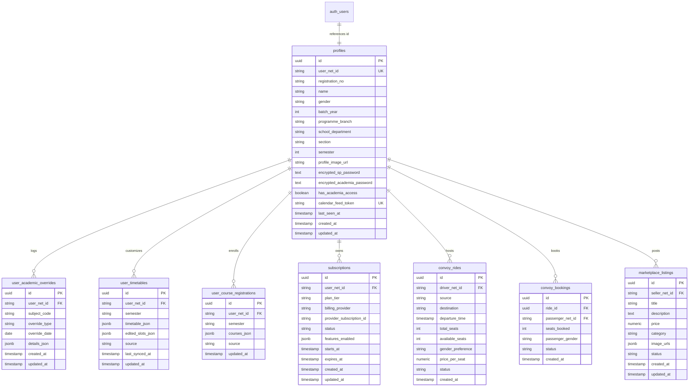
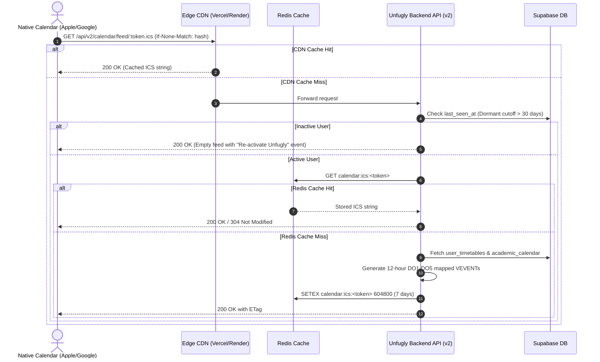

# Unfugly Ecosystem V3 Architecture Specification

> **Status:** Approved Architecture Draft  
> **Applies to:** Webapp (Primary), Backend API (v2), Extension (Companion), Convoy App, Campus Marketplace  
> **Target Graduation Batches:** Legacy (<=2029) and Modern (2030+)

---

## 1. System Vision & Product Evolution

Unfugly is transitioning from a Chrome-extension-first utility into an integrated, **Webapp-first university ecosystem** powered by a single Supabase backend and identity layer.

```mermaid
graph TD
    subgraph Identity & Data Layer
        SupabaseAuth[Supabase Native Auth (auth.users)]
        ProfilesTable[(profiles Table: Verified NetID, Gender, Batch, Vault)]
        RedisCache[(Redis: Hot Sessions, Calendar ICS Cache)]
    end

    subgraph Client Applications
        Webapp[Unfugly Webapp (Next.js - Primary Dashboard)]
        Extension[Chrome Extension (Companion Sync & Content Script)]
        Convoy[Convoy App (Campus Carpooling & Ride Sharing)]
        Marketplace[Campus Marketplace (Verified Student Commerce)]
    end

    subgraph External Portals
        SP[SRM Student Portal (sp.srmist.edu.in)]
        Academia[Legacy Academia (academia.srmist.edu.in)]
    end

    SupabaseAuth --> ProfilesTable
    Webapp --> ProfilesTable
    Convoy --> ProfilesTable
    Marketplace --> ProfilesTable
    Extension --> ProfilesTable

    Webapp -->|Decrypts In-Memory| SP
    Webapp -->|Batch < 2030 Only| Academia
    RedisCache -.-> Webapp
```

### Key Paradigm Shifts:
1. **Webapp-First**: The Next.js web application is the core hub for student operations. The Chrome extension is now an optional companion tool.
2. **Lean Persistence**: Unfugly no longer stores heavy raw marks and attendance dumps in PostgreSQL. Live data is fetched on demand or cached in Redis; only user-added overrides (expected marks, manual OD/ML) and structured timetables are permanently stored.
3. **Cross-Product Identity**: The unified `profiles` table powers:
   - **Unfugly Webapp**: Academic schedule, attendance prediction, SGPA simulation.
   - **Convoy**: Campus carpooling with verified gender filtering (`female_only`, `male_only`, `any`) directly from portal records.
   - **Campus Marketplace**: Verified student-to-student buying and selling with zero anonymous accounts.
4. **Monetization Layer**: Premium features (Calendar `.ics` feed, PYQ analysis & question bank) gated via a dedicated `subscriptions` table.

---

## 2. Database Schema (PostgreSQL / Supabase)

All tables use `snake_case` naming and are designed to be **strictly non-destructive**: existing `users`, `user_logs`, and `academic_calendar` tables remain intact for backward compatibility.

### 2.1 Entity Relationship Diagram



### 2.2 Table Specifications

#### `profiles`
- `id`: UUID Primary Key, foreign key referencing Supabase `auth.users(id)`.
- `user_net_id`: Unique SRM NetID (e.g., `gr2383`). Email is implicitly `${user_net_id}@srmist.edu.in`.
- `registration_no`: Official SRM Registration Number (e.g., `RA2311003010...`).
- `name`: Student's full name.
- `gender`: Verified student gender (`'male'`, `'female'`, `'other'`), scraped exclusively from Student Portal Personal Details (`iden=17`).
- `batch_year`: **Year of graduation** (e.g., `2026`, `2027`, `2028`, `2029`, `2030`).
- `has_academia_access`: Boolean computed as `(batch_year < 2030)`. Students graduating in 2030+ reside entirely on Student Portal.
- `programme_branch`, `school_department`, `section`, `semester`, `profile_image_url`.
- `encrypted_sp_password`: Combined string formatted as `base64(iv):base64(auth_tag):base64(ciphertext)` for Student Portal credentials (all students).
- `encrypted_academia_password`: Formatted as `base64(iv):base64(auth_tag):base64(ciphertext)` for Academia credentials (null for batch 2030+).
- `calendar_feed_token`: Secure random hex token for external `.ics` feeds.
- `last_seen_at`: Timestamp updated on webapp/extension activity for dormant account detection.

#### `user_academic_overrides`
- Stores user-added expected marks and manual OD/ML entries without persisting raw dumps.
- `override_type`:
  - `'expected_marks'`: User's simulated scores for internal evaluation components (CLA1, CLA2, FT1, Assignments) and expected End-Sem mark.
  - `'manual_od'`: Manually recorded On-Duty.
  - `'manual_ml'`: Manually recorded Medical Leave.
- `override_date`: Specific date chosen by the user.
- `details_json`:
  - For OD/ML: **Full-day by default**. Contains `{ "all_day": true, "excluded_hours": [], "category": "OD", "reason": "Tech fest" }`. When `all_day: true`, the prediction engine automatically flags all scheduled periods on that date's Day Order as attended via OD/ML.

#### `user_timetables`
- `timetable_json`: Weekly period matrix for Day Orders 1 through 5, supporting **up to 12 periods per day** (Hours 1 to 12).
- `edited_slots_json`: Custom modifications (user-renamed courses, room adjustments, swapped faculty).

#### `user_course_registrations`
- Stores current semester enrolled subjects:
  ```json
  [
    {
      "course_code": "21CSC302J",
      "course_title": "Database Management Systems",
      "credits": 4,
      "course_type": "Theory with Practical",
      "slot": "A1+TA1",
      "faculty_name": "Dr. ...",
      "room_no": "TP402"
    }
  ]
  ```

#### `subscriptions`
- Gating for paid features (`live_calendar_sync`, `pyq_predictions`).
- Tracks plan tier (`free`, `semester_pass`, `annual_pass`), expiration, and active status.

---

## 3. Cryptography: AES-256-GCM Vault

### What are IV and Tag?
- **IV (Initialization Vector / Nonce)**: A 12-byte cryptographically secure random number generated fresh on every encryption operation. Even if two users share the same password, their ciphertexts are completely distinct, preventing pattern analysis and rainbow table matching.
- **Auth Tag**: A 16-byte cryptographic checksum computed by Galois/Counter Mode (GCM). During decryption, GCM verifies that the ciphertext has not been modified or corrupted. If even one bit is tampered with in the database, decryption immediately rejects the payload.

### Combined Storage Format:
To avoid adding 6 separate database columns for IVs and Tags, credentials are encrypted and stored in a single unified string:
```text
encrypted_sp_password = "<base64_iv>:<base64_tag>:<base64_ciphertext>"
```
- Decryption is performed strictly **in-memory** on the server when a live sync or scraping job is initiated.
- Plaintext passwords and session cookies are never written to logs, console, or client responses.

---

## 4. Student Portal Scraper & CAPTCHA Breakthrough

### CAPTCHA Discovery
Inspection of the live Student Portal (`sp.srmist.edu.in`) traffic reveals that **the CAPTCHA is generated on the client side**:
1. When requesting `students/template/HRDSystem.jsp` or the login page, the server embeds the solution in the HTML source:
   ```html
   <script>
       window.SECURE_CONFIG = window.SECURE_CONFIG || {};
       window.SECURE_CONFIG.expectedDomain = 'sp.srmist.edu.in';
       window.SECURE_CONFIG.captchaText = 'QTztG9';
       window.SECURE_CONFIG.domainFieldName = 'dtoken_77ab6d';
       window.SECURE_CONFIG.captchaFieldName = 'cptoken_1625dd';
       window.SECURE_CONFIG.randomDelimiter = 'a335';
   </script>
   ```
2. The client script `guardlogin.js` draws the visual SVG from `captchaText` and injects two hidden fields on submit:
   - `dtoken_*`: Base64 of the reversed hostname (`btoa("ni.ude.tsimrs.ps")`).
   - `cptoken_*`: Base64 of `elapsedSeconds + randomDelimiter + interactionCount`.

### Automated Zero-Latency Login Handshake:
Because the solution is in the HTML:
- The backend or extension needs **no OCR and no external CAPTCHA solving service**.
- The login routine simply:
  1. GETs the login page to acquire a fresh `JSESSIONID` and the `SECURE_CONFIG` script block.
  2. Extracts `captchaText`, `domainFieldName`, `captchaFieldName`, and `randomDelimiter` using regex.
  3. Constructs the required payload with the student's credentials.
  4. POSTs the login form immediately, yielding an active session in under 300ms.
- *(For legacy Academia, the local Go solver on `localhost:8000/solve` remains available as an optional fallback).*

---

## 5. Software Features & Predictive Engines

### 5.1 Native Calendar Subscription Feed (`webcal://` / `.ics`) — *Paid Feature*



#### Shift Handling via Global Invalidation:
- **Global University Calendar**: SRM's day-order shifts are stored once in `academic_calendar` (e.g. `{ "2026-11-20": "DO4", "2026-11-21": "HOLIDAY", "2026-11-24": "DO5" }`).
- When a holiday shifts the schedule, the backend updates `academic_calendar` once ($O(1)$) and issues a Redis command `DEL calendar:ics:*`.
- No massive background jobs; as client devices ping the feed over the next 12 hours, the schedule recalculates automatically on cache miss.
- **Zombie Ping Defenses & Permanent Event Retention**:
  - `ETag` + `304 Not Modified` header check (sends 0 KB body for unchanged feeds).
  - **Permanent Semester Retention (No Calendar Wipes)**: Returning `410 Gone` causes Google and Apple Calendar to delete the entire calendar feed, erasing students' past class and attendance history. Instead, when a semester concludes, the server serves the final frozen schedule with `Cache-Control: public, max-age=31536000, immutable` and a terminal `ETag`. Any future check by the client immediately hits `304 Not Modified` (0 bytes body), keeping historical dates permanently on the user's phone with zero server computation.
  - Dormant account cutoff: Accounts inactive for >30 days receive an empty calendar with a reminder event.

### 5.2 Exam Timetable & Hall Ticket
- **Timetable (`iden=126`)**: Fetches subject code, course title, date, slot, and session (`FN`: 09:30 AM–12:30 PM, `AN`: 01:30 PM–04:30 PM).
- **Hall Ticket (`iden=42`)**: Closer to the exam date, SRM populates hall and seating allocations. The parser extracts Hall Number, Seat/Row Allocation, and reporting guidelines directly into the exam card.

### 5.3 SGPA & CGPA Predictive Modeling
- **Prior Academic Record**: Extracted from `studentMarksCredits.jsp` (`iden=8`) for historical credits and CGPA.
- **Current Enrolled Courses**: From `user_course_registrations`.
- **Formulas**:
  $$\text{SGPA} = \frac{\sum (\text{Course Credits} \times \text{Grade Point})}{\sum \text{Course Credits}}$$
  $$\text{CGPA}_{\text{new}} = \frac{(\text{Prior CGPA} \times \text{Prior Credits}) + (\text{Predicted SGPA} \times \text{Current Credits})}{\text{Prior Credits} + \text{Current Credits}}$$
- Incorporates user-defined expected marks from `user_academic_overrides` for instant "what-if" grade simulation.

### 5.4 Manual & Automated OD/ML Attendance Prediction
- **Graduating Batches <=2029**: Approved OD is not displayed on portals. Users log OD dates in the webapp; the engine assumes full-day coverage (all classes for that day order) and projects adjusted attendance percentages and safe bunks.
- **Graduating Batches 2030+**: Approved OD/ML hours appear directly in the Student Portal attendance table (`iden=9`). The parser ingests official OD automatically and merges user-added pending ODs for simulation.
- **Buffer Formula**:
  $$\text{Safe Bunks} = \left\lfloor \frac{\text{Attended Hours} + \text{OD Hours} - (0.75 \times (\text{Total Hours} + \text{Planned Hours}))}{0.75} \right\rfloor$$

### 5.5 Dynamic PYQ Analysis & Question Extraction — *Paid Tab*
- **Current-Semester Scoped Filtering**: The webapp automatically joins the user's current enrolled course codes from `user_course_registrations` with `pyq_questions`. Students are presented **only** with the PYQs matching their active semester courses, avoiding syllabus clutter.
- **Extraction Pipeline**: Instead of displaying static PDFs, questions are extracted and structured:
  ```json
  {
    "subject_code": "21CSC302J",
    "unit": 3,
    "marks": 16,
    "question_text": "Explain B+ Tree indexing with insertion and deletion algorithms.",
    "occurrences": 4,
    "exam_source": ["End-Sem Nov 2024", "End-Sem May 2025", "Model 2024"]
  }
  ```
- **Admin Ingestion**: The admin pastes raw paper text or uploads paper images/PDFs. The backend LLM/OCR worker extracts questions, assigns Bloom taxonomy levels, and indexes them by subject code.
- **Student Experience**: In a dedicated paid tab, students view high-probability questions grouped by syllabus unit, sorted by frequency, with practice tracking.

---

## 6. Payment & Subscription Provider Recommendation

For college students in India, **Razorpay Standard Checkout & UPI Payment Links** is the optimal choice:
- **Zero Friction**: 99% of Indian university students use UPI (Google Pay, PhonePe, Paytm). International processors (Stripe, Lemon Squeezy) require credit cards with 3D Secure, leading to >80% checkout abandonment.
- **Pricing Model**: **Semester Passes** (e.g., ₹49 to ₹99 per semester) or **Annual Passes** (₹149/year).
- **Integration**:
  1. Frontend calls `POST /api/v2/subscriptions/create-order`.
  2. Backend generates a Razorpay Order ID.
  3. Student completes UPI payment.
  4. Razorpay webhook hits `POST /api/v2/subscriptions/webhook`, verifying the payment signature and updating `subscriptions.status = 'active'`.

---

## 7. Multi-App Expansion: Convoy & Marketplace

### Convoy (Campus Carpooling)
- Built on top of the same `profiles` table.
- Drivers post rides with `gender_preference` (`'female_only'`, `'male_only'`, `'any'`).
- The booking system verifies the passenger's `profiles.gender` before confirming reservations, providing authentic portal-verified safety.

### Campus Marketplace
- Peer-to-peer buying and selling for textbooks, calculators, lab coats, and electronics.
- Verified accounts tied to SRM NetID eliminate anonymous scammers.

---

## 8. API Versioning & Route Monitoring Strategy

### 8.1 Route Versioning Guarantees
To ensure zero downtime and prevent breaking existing extension versions:
- **`/api/v1/...` (Strictly Frozen)**: Preserved exactly as-is for active extension builds (`/api/v1/user/save`, `/api/v1/auth/login`, `/api/v1/feedback`, etc.). No breaking changes or route renames may touch `/api/v1`.
- **`/api/v2/...` (Modern Architecture)**: Independent namespace for all V3 capabilities:
  - `POST /api/v2/auth/sync-session`
  - `POST /api/v2/user/vault-credentials`
  - `GET  /api/v2/calendar/feed/:token.ics`
  - `GET  /api/v2/exams`
  - `POST /api/v2/predict/sgpa`
  - `POST /api/v2/predict/attendance`
  - `GET  /api/v2/pyq/:subject_code`
  - `POST /api/v2/subscriptions/create-order`
  - `POST /api/v2/subscriptions/webhook`

### 8.2 Route Usage Monitoring
All incoming requests pass through a non-blocking telemetry middleware:
- **Structured Metrics**: Logs HTTP method, sanitized path (stripped of user tokens), status code, response time in ms, and caller `user_net_id`.
- **Redis Operational Counters**: Daily hit counters maintained via `HINCRBY api:metrics:<YYYY-MM-DD> "<METHOD> <ROUTE>" 1`. Provides instant traffic visibility without database writes or third-party overhead.

---

## 9. Portal Session Concurrency & Anti-Bot Behavior

### 9.1 SRM Academia Concurrency Rules
- **Concurrent Session Limits**: Academia allows a maximum of 2 active sessions.
  - **Second Session**: Triggers a preloader warning modal: *"Max session reached. Terminate other or skip."*
  - **Third Session**: Enforces a blocking gate requiring the user to terminate all other active sessions before proceeding.
- **Scraper Handshake**: When scraping Academia, the background worker detects the session warning DOM and automatically opts to terminate or reuse existing sessions.
- **CAPTCHA Trigger Condition**: Academia only presents a CAPTCHA if 5 consecutive failed logins occur from the same IP/client. A single valid authentication resets the counter. The extension can assist by autofilling the field on login.

### 9.2 SRM Student Portal Concurrency
- Student Portal (`sp.srmist.edu.in`) is decoupled from Zoho single-sign-on and does not enforce the 2-session termination gate, permitting reliable parallel background fetching once authenticated.
